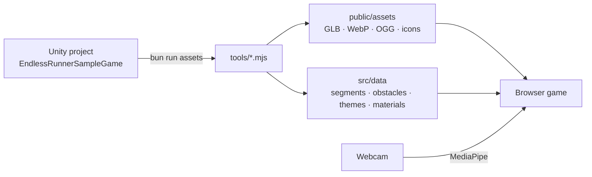
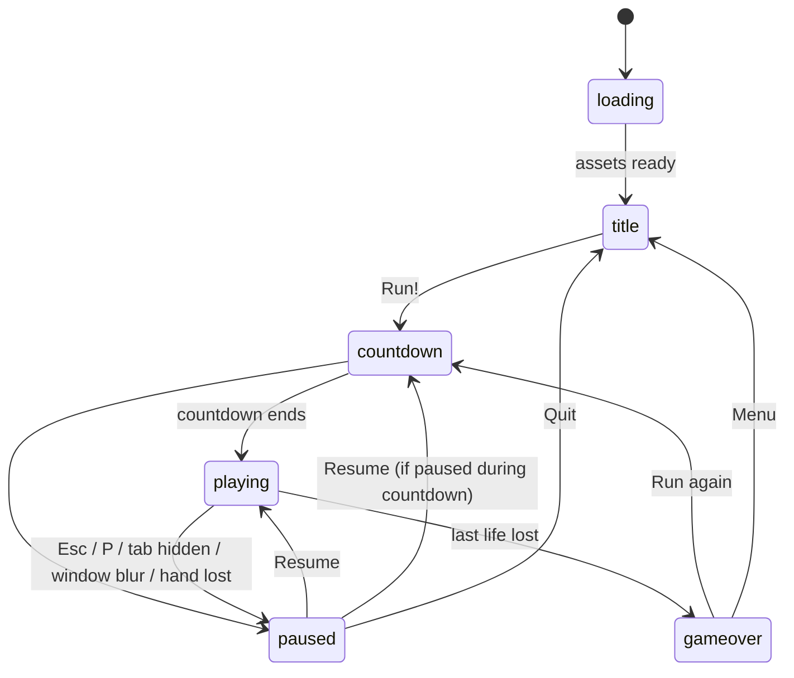
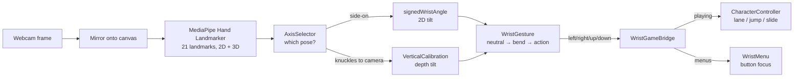

# Architecture

This document explains how Trash Dash is put together: how the original Unity
content becomes web assets, how a frame runs, and how each system (track,
character, rendering, UI, save data, wrist controls) works and connects to the
others.

## Contents

1. [Overview](#overview)
2. [Repository layout](#repository-layout)
3. [Asset pipeline](#asset-pipeline)
4. [Startup](#startup)
5. [Game states](#game-states)
6. [The frame loop](#the-frame-loop)
7. [Track generation](#track-generation)
8. [Character](#character)
9. [Obstacles, pickups and power-ups](#obstacles-pickups-and-power-ups)
10. [How systems talk to each other](#how-systems-talk-to-each-other)
11. [Rendering](#rendering)
12. [Camera](#camera)
13. [Audio](#audio)
14. [User interface](#user-interface)
15. [Save data and missions](#save-data-and-missions)
16. [Wrist controls](#wrist-controls)
17. [Testing](#testing)
18. [Deployment](#deployment)
19. [Known gaps](#known-gaps)

## Overview

| Concern | Technology |
|---|---|
| Language | TypeScript |
| 3D rendering | three.js (WebGL) |
| Dev server and bundler | Vite |
| Hand tracking | MediaPipe Tasks Vision (Hand Landmarker), loaded on demand |
| Unit tests | Vitest |
| Browser and screenshot tests | Playwright (desktop Chromium and Pixel 7 portrait) |
| Asset conversion | Node scripts using FBX2glTF, sharp and js-yaml |

The game has two halves:

- **Build time:** scripts in `tools/` read the original Unity project and write
  web-friendly files: models as GLB, textures as WebP, sounds as OGG, plus
  JSON that describes track segments, obstacles, themes and materials.
- **Run time:** the TypeScript in `src/` loads those files, builds the scene
  with three.js and runs the game. Most gameplay code is a direct port of the
  matching Unity C# script, and keeps the original constants, so the game
  plays like the original.



## Repository layout

```
src/
  main.ts                 Startup: load save, create Game, attach wrist controls
  game/
    Game.ts               Scene, frame loop, game states, connects every system
    CameraDirector.ts     The single camera and its menu / chase / death shots
  track/
    TrackManager.ts       Speed, score, segment queue, floating origin, pickup placement
    TrackSegment.ts       One street segment: visuals, colliders, path sampling
  character/
    Character.ts          Model loading and named animations
    CharacterController.ts  Lanes, jump, slide, keyboard and swipe input
    CharacterCollider.ts  Hit box, pickups, lives, post-hit invincibility
  obstacles/Obstacles.ts  Obstacle spawning, behaviour and hit volumes
  consumables/Consumables.ts  Power-up and sardine pickups, active effects
  coins/CoinPool.ts       256 pooled fishbones drawn as one instanced mesh
  environment/EnvironmentManager.ts  Drifting cloud field
  rendering/              Materials, post-processing, particles, sky, shadow, quality scaling
  audio/AudioManager.ts   Web Audio: effects, music, footsteps, wind
  ui/                     HTML/CSS overlay (UI.ts, ui.css)
  save/                   Save file (PlayerData.ts) and missions (Missions.ts)
  input/                  Webcam wrist controls
  core/                   Asset loading/caching, gameplay constants, seeded random
  data/                   JSON generated by the asset pipeline, plus typed views of it
tools/                    Asset pipeline scripts
tests/                    Vitest unit tests; tests/visual holds Playwright specs
public/assets/            Generated assets (not committed)
```

## Asset pipeline

`bun run assets` runs these scripts in order. Each one skips outputs that are
newer than their inputs, so running it again is cheap. The Unity project is
only read, never changed. Its location comes from `UNITY_SOURCE_DIR`, or
defaults to `../EndlessRunnerSampleGame` next to this repository
(`tools/lib/unity.mjs`).

| Step | Script | Output |
|---|---|---|
| Textures | `convert-textures.mjs` | TIFF colour maps → WebP; particle and UI PNGs copied |
| Models | `convert-models.mjs` | Every FBX → binary glTF (GLB) through FBX2glTF, with pivot fixes (`lib/fbx-pivot.mjs`, `lib/glb-recenter.mjs`) |
| Segments | `extract-segments.mjs` | Each Unity track-segment prefab → `src/data/segments/<theme>/<name>.json` (path points, obstacle slots, scenery node tree), plus `obstacles.json` |
| Themes and materials | `build-manifest.mjs` | `themes.json` (zones, fog, sky, clouds, prices) and `materials.json` (shader type, texture and tint for each Unity material) |
| Audio | `copy-audio-fonts.mjs` | OGG sound effects and music |
| Icons | `extract-ui-icons.mjs` | HUD and menu icons cut from Unity's sprite sheet, and the logo |
| Check | `validate-assets.mjs` | Fails if anything referenced is missing |

Unity stores prefabs, materials and theme settings as YAML text.
`tools/lib/unity.mjs` and `tools/lib/prefab.mjs` read that YAML directly, so
you don't need the Unity editor. Unity object IDs stay as strings, because
they're 64-bit numbers that JavaScript would round.

**Textures are not embedded in the models.** The texture paths inside the FBX
files don't resolve, so `AssetManager` rebuilds every material at run time
from `materials.json`.

## Startup

`src/main.ts` sets things up in this order:

1. Load the save from `localStorage` (`playerData.load()`).
2. Read the optional test URL parameters `?seed=&theme=&segment=&mirror=`.
   These make a run repeatable: a fixed random seed, a forced theme, one
   repeated segment, and fixed mirroring.
3. Create `Game`. Its constructor creates the renderer, scene, fog, lights,
   post-processing, `TrackManager` and `EnvironmentManager`, and registers the
   resize, visibility and first-gesture audio unlock listeners.
4. Expose `window.__game` so the browser console and Playwright tests can
   inspect the game.
5. `await game.load()`:
   - Start decoding audio and request the menu music.
   - Make sure two missions are active, and save.
   - Load the coin pool, the selected character and the power-up models in
     parallel.
   - Create the controller, collider, power-up system, camera director, ground
     haze, shadow, sky dome, particle effects and shield.
   - Build the opening street (`trackManager.begin`) and the cloud field.
   - Wait until every texture request has finished, so the title never shows
     untextured scenery. Progress updates the loading bar through three.js's
     `DefaultLoadingManager`.
   - **Warm up the renderer:** compile every shader and render both the chase
     and menu views once behind the loading screen, so the first frames of a
     run don't stutter.
   - Attach game events, input and UI callbacks. Switch to `title` and start
     the animation loop.
6. Create `WristGameBridge` and `WristCameraControls` (see
   [Wrist controls](#wrist-controls)).

## Game states

`Game` owns a small state machine:



- **title:** the character idles while the camera shows it from the front.
  The loadout card lets you pick a character and theme, and buy them.
- **countdown:** 3-2-1-Go. The camera blends into the chase view. The track
  starts moving when the countdown ends.
- **playing:** the gameplay systems update every frame.
- **paused:** nothing is simulated and audio is suspended. The scene is still
  drawn behind the pause card.
- **gameover:** the death animation plays for 1.3 s, then the results card
  shows the score, best score, leaderboard and missions you can claim. Coins,
  sardines and the score are saved at this point.

While a character or theme swap is loading, `loadoutLocked` is true. Menu
clicks and wrist menu actions are ignored until it finishes.

## The frame loop

`Game.frame()` runs once per animation frame:

1. Read the frame time from `THREE.Timer`. The time step used for simulation
   is capped at 50 ms, so a hitch doesn't teleport the runner. The timer also
   ignores time spent in a hidden tab.
2. Feed the frame time to `RenderQuality`, which may change the render
   resolution (see [Rendering](#rendering)).
3. Update for the current state:
   - **countdown:** count down and start the run when it reaches zero.
   - **playing:** update `TrackManager` (moves the runner), then
     `CharacterController`, `CharacterCollider`, power-ups and mission
     progress. Then update the HUD, show milestone messages, and handle
     footstep sounds, dust and power-up auras.
   - **gameover:** let a mid-air death fall to the ground, then show results.
4. Unless paused: advance the character animation, camera, particles, and the
   power-up rim light and shield.
5. Update the contact shadow, the speed-line strength and the motion-driven
   audio (wind, footsteps).
6. Draw through the post-processing chain.

## Track generation

`TrackManager` is a port of Unity's `TrackManager.cs`.

**Segments.** The street is built from authored segments, each 9 to 27 units
long. A `TrackSegment` holds the segment's scenery, its colliders, and a path:
a list of points the runner follows, with straight lines between them.
`getPointAt(t)` gives the position and direction at a fraction of the way
along. Ten segments are kept ahead of the runner at all times. Each new segment
is rotated and moved so its start meets the end of the previous one. Each one
is also randomly mirrored left-to-right, as in the original.

**Themes and zones.** A theme (day or night) is a list of zones, and each zone
has its own pool of segments. After a zone's length has been covered, the
generator moves on to the next zone. It never picks the same segment twice in
a row.

**Moving the runner.** The track doesn't move. Each frame, the runner's
distance along the current segment increases by `speed × dt`, and
`characterRoot` is placed at that point on the path. Once the runner passes the
end of a segment, that segment moves to a "past" list. It's removed when it's
30 units behind.

**Speed and score.** Speed starts at 5 units/s and rises by 0.2 units/s² up to
10 units/s. The multiplier is `1 + floor(speedRatio × 4)`, so ×1 to ×5. Score
goes up by distance × multiplier, and Score ×2 doubles the multiplier.

**Floating origin.** Floating-point precision drops far from the origin. When
the runner gets more than 100 units from (0,0,0), every segment and active coin
is shifted back toward the origin. A `recenter` event lets particle effects
move with them.

**Backdrop.** On the title screen the camera looks back down the street, so
about 45 units of obstacle-free segments are added *behind* the start line.
Without them the view would be empty.

**Fair obstacle spacing.** Each segment has a few authored obstacle slots. A
slot is left empty if it sits too close behind the previous obstacle for the
player to react. The minimum gap depends on how demanding both obstacles are
(`OBSTACLE_GAPS` in `core/consts.ts`). For example, after a wall that blocks
every lane, the next barricade must be at least 16 units away, which is
1.6 s at top speed. The first 55 units of every run have no obstacles.

**Coins and pickups.** Coins are placed every 1.5 units in runs along a lane.
The lane shifts as it goes, and obstacles are avoided. Power-ups and sardines
spawn more often the longer it's been since the last one. `TrackManager` only
decides *where* a pickup goes. It fires `spawnPowerup` and `spawnPremium`
events, and `Game` creates the pickups.

## Character

**`Character`** loads the cat or raccoon model and exposes `play(name, fade)`
for named animations (idle, start, run, jump, slide, hit, death), in place of
Unity's Animator. Both characters share one skeleton, so the cat's animation
clips drive both.

**`CharacterController`** is a port of `CharacterInputController.cs`.
`TrackManager` moves `characterRoot` along the path. The controller moves a
child object, `holder`, sideways for lanes (1.5 units apart) and up for jumps.
Jump and slide length are measured in distance along the track, not time, so
they cover the same ground at any speed: a jump is 2 units long and 1.2 high,
and a slide is 2 units long. On top of the original it adds:

- a 0.18 s input buffer, so a jump or slide pressed just before landing still
  happens;
- fast-fall: pressing slide in mid-air drops straight into a slide;
- a slight body lean while changing lanes;
- swipe detection that ignores small finger movements and taps on buttons.

`inputEnabled` is only true while playing. `inputRevision` changes whenever
the meaning of input changes, and the wrist controls watch it.

**`CharacterCollider`** is a port of `CharacterCollider.cs`. Each frame it
places a box around the runner (shorter while sliding) and tests it against
the colliders of nearby segments:

- coin, sardine or power-up: collect it and fire an event;
- obstacle: lose a life, then 2 s of invincibility shown by blinking, or fire
  `death` on the last life;
- an obstacle passing under the runner during a jump counts toward the "jump
  over barriers" mission.

## Obstacles, pickups and power-ups

**Obstacles** (`obstacles/Obstacles.ts`) are built from `obstacles.json`:

| Type | Behaviour | Difficulty used for spacing |
|---|---|---|
| Barricade | Blocks one or two lanes | `open` or `narrow` |
| All-lane barrier | Blocks every lane; jump or slide | `wall` |
| Patrolling rat | Runs back and forth across lanes | `moving` |
| Missile (dog) | Charges toward the runner | `moving` |

Some obstacles use a hand-made hit box instead of their drawn shape. The rat's
model bounds include its rest pose and shadow, and the high barrier's bounds
include its side posts, which would fill the gap you're meant to slide through.
Moving obstacles register an update function on their segment. It only runs
while the runner is close.

**Coins** (`coins/CoinPool.ts`) are a pool of 256 lightweight placeholder
objects. One `InstancedMesh` draws them all in a single draw call.

**Power-ups** (`consumables/Consumables.ts`):

| Power-up | Duration | Effect |
|---|---|---|
| Magnet | 15 s | Pulls nearby coins toward the runner |
| Score ×2 | 10 s | Doubles the score multiplier |
| Invincibility | 10 s | No damage; shield effect around the runner |
| Extra Life | instant | Restores a life, or gives coins if lives are full |

`ConsumableSystem` tracks active power-ups and their remaining time. The HUD
shows a ring for each one, and the runner's rim light takes on the colour of
the active power-up.

## How systems talk to each other

Gameplay systems don't call audio, effects or the UI directly. They fire DOM
`CustomEvent`s on their own `events` target, and `Game.bindGameplayEvents()`
connects those events to everything else. Each system can then be tested on
its own.

| Source | Event | Game reacts by |
|---|---|---|
| `TrackManager` | `spawnPowerup`, `spawnPremium` | Creating the pickup on the segment |
| `TrackManager` | `recenter` | Moving the particles by the same offset |
| `CharacterCollider` | `coin` | Mission progress, sparkle, coin sound (pitch rises with quick pickups, panned to the lane) |
| `CharacterCollider` | `premium` | Effect, sound, "+1 Sardine" message |
| `CharacterCollider` | `powerup` | Activating it, effect, sound, message |
| `CharacterCollider` | `hit` | Impact sound for that obstacle, camera shake, red flash, hit animation |
| `CharacterCollider` | `death` | `endRun()` |
| `CharacterCollider` | `recovered` | Going back to the run animation |
| `CharacterCollider` | `barrierJumped` | Mission progress |
| `CharacterController` | `onJump` / `onSlide` / `onLand` | Sounds, dust, camera landing dip |

## Rendering

**Curved world.** The original's signature look is a road that bends down
toward the horizon. `rendering/CurvedMaterial.ts` adds the same curve to
three.js shaders: after projection, each vertex is pushed down by
`curve × depth²`. Doing it after projection, as Unity does, keeps the
perspective and segment seams intact. Unity's shader types (opaque,
transparent, cloud, blinking, vertex-colour, standard) each have a matching
material. The runner gets its own lit material: soft wrap-around lighting, a
coloured shadow side, and a rim light that also shows the power-up colour and
the invincibility blink.

**Mirroring.** The converted models come out mirrored compared with Unity, so
`AssetManager.loadModel` wraps every model in a group with `scale.x = -1`. As
a result the whole world is a consistent mirror image of Unity's. That's why
the controls map screen-left to lane +1 (`CharacterController`). If you change
one of these, change the other as well. Flat, single-sided scenery (walls,
fences) is drawn double-sided, because the conversion loses which side faces
out.

**Assets.** `core/AssetManager.ts` loads and caches GLB models and textures.
Loads of the same file share one request, and failed loads can be retried. It
turns a segment's node tree from the JSON into three.js objects, with the right
material for each part.

**Post-processing** (`rendering/PostProcessing.ts`) runs bloom first, then one
grading pass: vignette, saturation, contrast and a per-theme colour lift. The
same pass draws speed lines at the screen edges near top speed, and a red
flash when you're hit. Day keeps bloom almost off. Night blooms only the
bright lamps, then darkens the image.

**Scene extras:**

| File | Purpose |
|---|---|
| `SkyDome.ts` | Gradient sky that follows the runner (replaces Unity's sky mesh) |
| `GroundHaze.ts` | Fills the empty space beside the street |
| `CharacterShadow.ts` | Soft shadow under the runner that fades during jumps |
| `ShieldAura.ts` | Invincibility bubble |
| `Effects.ts` | GPU particles using the original particle textures: coin sparkles, footstep and landing dust, impact smoke, power-up auras |
| `ThemeLook.ts` | Per-theme fog, ground, light and character lighting |
| `environment/EnvironmentManager.ts` | Clouds that drift with parallax; ones that fall behind are moved back in front |

**Resolution and performance** (`rendering/RenderQuality.ts`). The render
resolution is capped at 3 million pixels and a pixel density of 2. Every 2 s,
`RenderQuality` checks the average frame time. Above about 23 ms, it lowers the
resolution in steps of 10%, down to 65%. After 10 s below about 18 ms, it
raises it again in 5% steps. The UI always stays at full sharpness.

## Camera

`game/CameraDirector.ts` controls the only camera. It has three shots, all
positioned relative to the runner so they follow the street's turns:

- **menu:** a low three-quarter view in front of the idle character, with room
  for the loadout card;
- **follow:** the original chase camera, plus a slight lean toward your lane,
  a lift during jumps, a wider field of view at speed, a shake on hits and a
  dip on landing;
- **death:** swings round to the front to watch the fall.

When switching shots, the camera moves in an arc over the runner's head. A
straight line from the front view to the chase view would pass through the
character, and a sideways orbit would hit the alley walls. Camera following
uses frame-rate-independent smoothing. The field of view adjusts on wide
screens so the horizontal view matches the original. Motion effects are
reduced when the system's reduce-motion setting is on.

## Audio

`audio/AudioManager.ts` uses the Web Audio API.

- All 21 sound effects and the music are downloaded and decoded during
  loading, so nothing has to load on the first input.
- Browsers block sound until the user interacts with the page. The first
  click, tap or key press, even during loading, unlocks the audio. If autoplay
  is blocked, the title shows an **Enable sound** button.
- Effects can be detuned (the rising coin pitch) and panned (toward the
  runner's lane). Late effects are dropped rather than played after a pause.
- Music crossfades between menu and death tracks.
- `setMotion()` drives a quiet wind sound that grows with speed, and
  `footstep()` plays alternating left and right steps based on distance run.
- Mute is saved. Pausing or hiding the tab suspends audio.

## User interface

`ui/UI.ts` and `ui/ui.css` build the interface in HTML and CSS on top of the
canvas, inside `#ui-root`. There are four screens, each a `.screen` element:
loading, title (with the loadout), pause and game over. The HUD (lives,
fishbones, score, multiplier, power-up rings, messages, countdown) sits on top
of them.

- The UI only shows things and reports clicks. `Game` sets callbacks
  (`onStart`, `onResume`, …) and supplies data such as `LoadoutView`,
  `HudState` and `RunResult`.
- HUD updates compare each value with the last one written, so during a steady
  run the page only changes when a number changes.
- `#ui-root[data-screen]` names the visible screen. Wrist menu navigation uses
  it to notice screen changes.

## Save data and missions

**`save/PlayerData.ts`** stores one versioned JSON object in `localStorage`
under `trash-dash-save`. It holds coins, sardines, owned and selected
character and theme, the top-10 leaderboard, missions, mute and the run count.
Older saves are upgraded automatically.

**`save/Missions.ts`** is a port of `Missions.cs`. There are five mission
types, each with four levels, and the reward is level + 1 sardines:

| Type | Goals |
|---|---|
| Run in a single run | 500 / 1000 / 1500 / 2000 m |
| Collect fishbones | 1000 / 2000 / 3000 / 4000 |
| Jump over barriers | 20 / 50 / 75 / 100 |
| Slide | 20 / 30 / 75 / 150 m |
| Reach a multiplier | ×2 / ×3 / ×4 / ×5 |

Two missions are always active. `MissionProgress` updates them during a run.
Completed missions are claimed on the results screen and replaced. Saves with
multiplier goals that can't be reached (old ×8 or ×10 goals) are fixed on load,
and their progress is kept.

## Wrist controls

The code is in `src/input/`. It's split so that the gesture logic runs without
a camera or a browser:



| File | Purpose |
|---|---|
| `WristCameraControls.ts` | The panel, camera, MediaPipe set-up, the processing loop, preview drawing and status text |
| `WristGesture.ts` | Plain functions and classes: angle maths, pose selection, calibration, and the gesture logic |
| `WristGameBridge.ts` | Turns the four actions into game commands depending on the game state |
| `WristMenu.ts` | Moves focus between menu buttons and clicks them |
| `wristTypes.ts` | Types shared between the files above |

### Camera and tracking

- Clicking **Enable camera** requests a 640×480 front-camera stream. The
  MediaPipe library and the hand model load only then, from jsDelivr and
  Google's model storage. The model runs on the **CPU**, so it doesn't compete
  with the game's WebGL rendering for the GPU.
- Each frame is mirrored onto a canvas *before* detection, so left and right
  match what the player sees, like a mirror. This matches `cv2.flip(frame, 1)`
  in the Python prototype (`wrist_flexion_v2.py`) the controls were ported from.
- Detection runs at most 20 times a second, and never twice on the same video
  frame.
- Settings are saved under `trashdash.wristControls`: whether the camera is on,
  and the jump/slide swap. On a return visit the camera restarts on its own if
  the Permissions API says camera access was already granted.
- The camera stops on **Disable camera**, when the tab is hidden, when the
  page is closed, or when the camera is unplugged. Each failure has its own
  message (permission denied, no camera, camera busy).

### Telling the two poses apart

`knuckleYaw()` measures the line across the knuckles, from index knuckle
(landmark 5) to pinky knuckle (17), using MediaPipe's 3D landmarks. When the
hand is side-on, that line points toward the camera. When the knuckles face
the camera, it runs across the image. Bending the wrist rotates the hand
*around* this line, so a bend never changes which pose is detected.
`AxisSelector` switches to side-on above 55° and to knuckles-to-camera below
35°, and the new pose must hold for 150 ms. That prevents flicker between
poses while you turn your forearm. Changing pose also resets the gesture logic,
so turning your arm mid-bend can't fire the other pose's action.

### Measuring the bend

- **Side-on (left/right):** `signedWristAngle()` measures the angle from the
  wrist (landmark 0) to the middle knuckle (landmark 9), against straight up,
  in the 2D image. This is the same calculation as the Python prototype.
  Negative angles are screen-left.
- **Knuckles to camera (up/down):** this bend happens toward and away from the
  camera, so `depthPitch()` uses the 3D landmarks to measure how far the hand
  tilts in depth. `VerticalCalibration` converts that into a bend angle:
  - The camera rarely looks exactly along your forearm, so the first steady
    straight pose sets zero. That pose must be held still (within 6°) for
    300 ms. While your wrist stays straight, zero follows slow changes in
    posture over about 2 s.
  - Whether flexion moves your knuckles toward or away from the camera depends
    on whether your palm faces the camera. `palmTowardCamera()` works this out
    from where the curled fingers sit, falling back to MediaPipe's left/right
    hand label if the hand is open. The answer is only updated while the wrist
    is near straight, so it can't flip mid-bend.
  - The **Swap jump and slide** option reverses the result, for anyone whose
    palm direction is misread.
  - Zero is learned again after 3 s without a hand, or when you click
    **Re-center up/down**.

### From angles to actions

`WristGesture` works like a keyboard key for each direction:

1. **Straight first.** You must hold within ±12° for 120 ms before anything
   fires. This also applies after losing tracking, changing pose or a change
   in what the game is doing.
2. **Bend.** Left/right fires past 12°. Up/down fires past 20°: between 12°
   and 20° a bend that's already active stays active, but a new one doesn't
   start. The bend must hold for 120 ms.
3. **Repeat.** A held side-on bend repeats after 400 ms, then every 250 ms, like
   holding an arrow key. Jump and slide fire once per bend. A repeat only fires
   on a new camera reading, so a stalled camera never causes a burst of moves.
4. **Gaps in tracking.** If a few frames miss the hand, the gesture logic waits
   and keeps your progress. If the hand is gone for more than 750 ms, you have
   to start from straight again.

The `WristGestureState` values (`ready`, `center`, `aiming`, `lost`, or the
current action) drive the indicator and status text in the panel.

### Applying actions to the game

`WristGameBridge` implements the `WristTarget` interface:

- **`context`:** `run` while playing; `menu` on the title, pause and game-over
  screens, unless a loadout swap is loading; otherwise `idle`, where gestures
  are ignored.
- **`perform(action)`:** during a run, left/right call `moveHorizontal()`, up
  calls `jump()` and down calls `slide()`. In menus the action goes to
  `WristMenu`.
- **`revision`:** a number that changes when the game state, the controller's
  `inputRevision` or the visible screen changes. The camera loop resets the
  gesture whenever it changes, so you can't keep a bend held from one screen
  into the next.
- **`trackingLost()`:** pauses the run once the hand has been gone for 1.5 s.
  This only happens if the hand was seen earlier in that run.
- **`hints()`:** the labels shown in the panel for each action.

`WristMenu` uses `DomMenuSurface`, which finds the visible, enabled buttons on
the current `.screen` in reading order. It ignores the wrist panel's own
buttons. Left/right move focus (wrapping round), up clicks the focused button
with a real `click()` so the normal UI handlers and audio unlock run, and down
jumps back to the screen's main button. Focus is tracked by a stable key based
on the button's data attributes, so it survives the UI rebuilding the screen.
The focused button gets the `wrist-focus` CSS class.

## Testing

**Unit tests** (`bun run test`, Vitest, in `tests/`):

| File | Covers |
|---|---|
| `assets.test.ts` | Unity object IDs read exactly, generated segments only reference files that exist, every obstacle has a model, only supported shader types (some checks skip when the Unity project isn't available) |
| `materials.test.ts` | Unity materials are assigned to the right model parts |
| `collisions.test.ts` | Obstacle hit volumes: jumping clears the rat, sliding passes under the high barrier |
| `missions.test.ts` | Mission goals can be reached, and old impossible goals are fixed |
| `startup.test.ts` | Shared model loads and retries, resolution cap and adaptive resolution |
| `wrist.test.ts` | Angle maths matches the Python prototype; gesture timing, repeats, pose switching, calibration |
| `wristMenu.test.ts` | Menu focus movement, clicking, focus surviving screen rebuilds |
| `syntheticHand.test.ts` | The fake hand generator used by the wrist tests |

`tests/helpers/syntheticHand.ts` builds a realistic 3D hand, posed by
forearm direction, wrist bend and palm direction. Its maths is independent of
`src/`, so the wrist tests check the real code against an independent
reference rather than against itself.

**Browser tests** (`bun run test:visual`, Playwright) run against
`bun run preview`, so **build first** or they test old code. Each test runs on
desktop Chromium and in Pixel 7 portrait emulation:

- `runner.spec.ts`: screenshot comparisons of fixed day and night scenes (set
  with `?seed=&theme=&segment=&mirror=`), a limit on how much the scene
  draws, theme changes that don't leak resources, a long run across many
  recentres, the title view, and a full countdown → run → game over → menu
  flow.
- `startup.spec.ts`: the first click or key press starts the preloaded music
  (checked with a Web Audio analyser), mute/pause/resume keep the audio state,
  the first **Run!** click works while sound unlocks, and changing theme while
  paused stays paused.
- `wrist.spec.ts`: drives the real wrist panel with a fake MediaPipe that
  returns synthetic hands. It covers held bends and repeats, both jump/slide
  palm directions, switching poses, tracking loss and auto-pause, camera
  failures and retries, and a whole session played by wrist alone.

Headless Chromium renders WebGL in software, so tests allow 30 s for the game
to load and 60 s per test. `bun run test:visual:update` updates the reference
screenshots. Only run it when a visual change is intended.

## Deployment

`bun run build` type-checks the code and writes a static site to `dist/`. The
site is deployed to Vercel **from the command line** (`vercel deploy --prod`),
not by connecting the GitHub repository. `public/assets` isn't committed, so
a build from the repository would have no models or textures. The CLI uploads
the local folder, including the generated assets. `.vercelignore` leaves out
tests, tools and reports, but deliberately *keeps* `public/assets`.

## Known gaps

- The original's dog model and menu characters are missing from the Unity
  project (the Git LFS files can't be downloaded). The dog obstacle uses a
  simple stand-in model until the real one is available and the assets are
  regenerated.
- The original's layered adaptive music, character accessories and tutorial
  aren't ported yet.
- Wrist jump and slide rely on MediaPipe's depth estimate, which is noisier
  than its 2D positions. The **Swap** and **Re-center** buttons exist for
  that reason.
