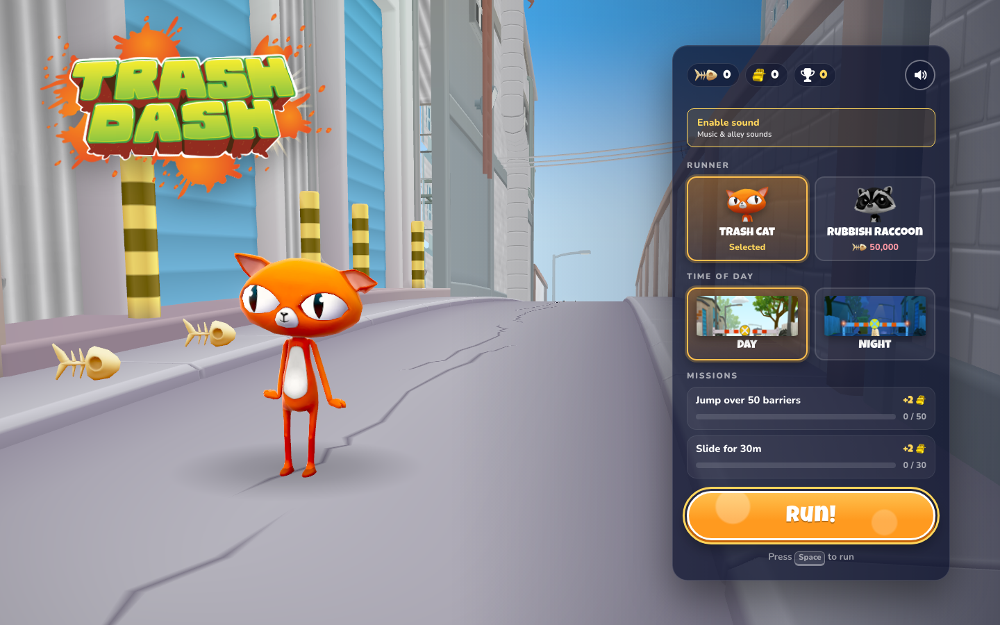

# Trash Dash

Trash Dash is an endless runner that plays in the browser. You run down a
city alley as Trash Cat, dodging barriers and rats and picking up fishbones.
The longer you last, the faster it gets. You can play with the keyboard,
by swiping on a touch screen, or by bending your wrist in front of a webcam.

It's a web version of Unity's *Trash Dash* sample game, built with
[three.js](https://threejs.org), and it uses the original game's art, animation
and sound.



## How to play

- **Three lanes.** Switch lanes to get around obstacles, jump over low
  barriers and slide under high ones. Some barriers fill every lane, so you
  have to jump or slide.
- **Three lives.** A hit costs a life and makes you briefly invincible. Lose
  all three and the run is over.
- **Speed and score.** You keep speeding up during a run. The score
  multiplier rises with your speed, up to ×5.
- **Fishbones** are the main currency. **Sardines** are a rarer currency,
  found on the track or earned from missions.
- **Power-ups:** Magnet (pulls in nearby fishbones), Score ×2, Invincibility,
  and Extra Life.
- **Missions.** Two are active at a time, for example "Jump over 50
  barriers" or "Slide for 30m". Finish one to earn sardines.
- **Unlocks.** Spend your currency on a second character (Rubbish Raccoon)
  and a night version of the alley.
- Your progress, unlocks and top-10 scores are saved in the browser.

### Keyboard and touch

| Action | Keyboard | Touch |
|---|---|---|
| Change lane | ← / → or A / D | Swipe left / right |
| Jump | ↑, W or Space | Swipe up |
| Slide | ↓ or S | Swipe down |
| Start a run | Space or Enter | Tap **Run!** |
| Pause / resume | Esc or P | Pause button |
| Mute / unmute | M | Sound button |

If you press jump or slide just before landing, the move happens as you touch
down. If you press slide in mid-air, you drop straight into a slide.

## Running it locally

You need [Node.js](https://nodejs.org) 20.19 or newer.

### 1. Get the original game's assets

The models, textures and sounds aren't in this repository. A script generates
them from Unity's original Trash Dash project, so download that first. It
stores its large files with Git LFS:

```bash
git lfs install
git clone https://github.com/Unity-Technologies/EndlessRunnerSampleGame.git
```

By default, the script looks for `EndlessRunnerSampleGame` in the folder that
contains this repository, so the two folders sit side by side. If you put it
somewhere else, set `UNITY_SOURCE_DIR` to its path.

### 2. Install and generate the assets

```bash
bun install
bun run assets                                     # writes public/assets and src/data
# or: UNITY_SOURCE_DIR=/path/to/EndlessRunnerSampleGame bun run assets
```

You only have to do this once. Running it again skips files that are already
up to date.

### 3. Play

```bash
bun run dev        # open http://localhost:5173
```

Other commands:

```bash
bun run build      # production build in dist/
bun run preview    # serve that build locally
bun run test       # unit tests (not `bun test`, which skips Vitest)
bun run test:visual  # browser tests and screenshot comparisons (run bun run build first)
```

## Wrist controls

You can play the whole game, including menus, by moving one wrist in front of
your webcam. Hand tracking runs in your browser using
[MediaPipe](https://ai.google.dev/edge/mediapipe/solutions/vision/hand_landmarker).
Video never leaves your computer. The first time you turn it on, the browser
downloads the hand-tracking model (a few MB).

### Turning it on

1. Open the **Wrist controls** panel in the bottom-left corner.
2. Click **Enable camera** and allow camera access. This works on `localhost`
   or an HTTPS site.
3. Next time you visit, the camera starts on its own if your browser
   remembers the permission.

### The two poses

Make a fist and hold your forearm upright. The way your hand faces the camera
decides what a bend does:

| Pose | Bend | During a run | In menus |
|---|---|---|---|
| **Side-on** (thumb side or pinky side toward the camera) | Tilt left | Move one lane left | Previous button |
| | Tilt right | Move one lane right | Next button |
| **Knuckles toward the camera** | Bend back (extension) | Jump | Press the highlighted button |
| | Bend forward (flexion) | Slide | Jump to the main button (Run!, Resume, …) |

To switch between steering and jumping/sliding, turn your forearm between the
two poses.

### How a move is recognised

- **Start straight.** Hold your wrist straight (within about 12°) until the
  panel shows **Ready**. Moves only count after you've started from straight,
  so you can't trigger one by accident while bringing your hand into view.
- **Bend and hold briefly.** Left/right fires at about 12° of bend. Jump and
  slide need about 20°, because judging depth from a webcam is less exact.
  Hold the bend for a moment (about 0.1 s) so small twitches are ignored.
- **Steering repeats like a held arrow key.** Keep tilting and you move
  another lane after 0.4 s, then every 0.25 s. Straighten to stop, or tilt the
  other way to reverse.
- **Jump and slide fire once per bend.** Straighten your wrist before the next
  one.
- **Knuckles-to-camera needs a moment to set up.** The first time you turn to
  this pose, hold your wrist straight and still until the panel says it's
  ready. That sets "straight" for your camera angle. If jump and slide start
  to feel off, click **Re-center up/down**.
- **Swap jump and slide.** If jump and slide come out the wrong way round for
  you, tick **Swap jump and slide**. The setting is saved.
- **Hide your hand to pause.** If your hand is out of view for 1.5 seconds
  during a run, the game pauses. After that, start from a straight wrist
  again.

The preview in the panel draws the lines it tracks: wrist to middle knuckle in
green, straight up in blue, and your knuckles in orange. For jump and slide it
also shows a meter, because bending toward the camera is hard to see in a
flat image. The status text tells you what to do next, for example **Center
wrist**, **Hold bend** or **Find hand**.

The keyboard and touch controls keep working while the camera is on. The
camera turns off when you click **Disable camera**, switch tabs, or leave the
page.

## Learn more

[ARCHITECTURE.md](ARCHITECTURE.md) explains how the code is organised.
